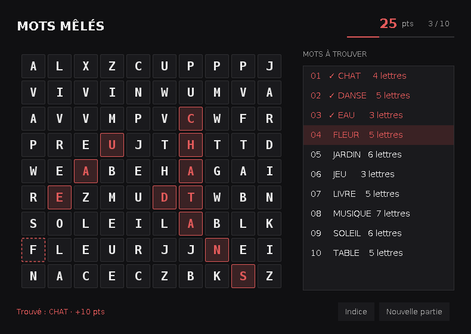
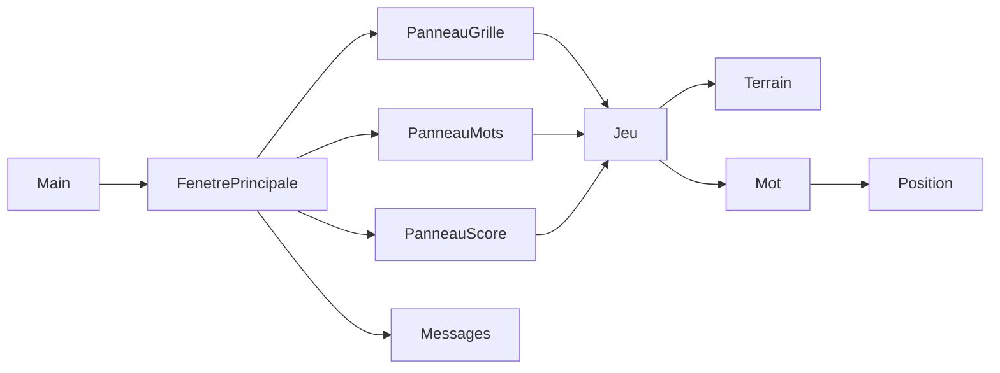

<div align="center">

<h1>MOTS MÊLÉS</h1>

[](https://openjdk.org/projects/jdk/21/)
[](https://docs.oracle.com/javase/tutorial/uiswing/)
[](#jouer)
[](#jouer)
[](#jouer)
[](#jouer)
[](#aperçu)
[](#lancer-le-jeu)
[](#lancer-le-jeu)

[](https://github.com/nyx-deb/mots-meles/commits/master)
[](https://github.com/nyx-deb/mots-meles/graphs/commit-activity)
[](https://github.com/nyx-deb/mots-meles/issues)
[](https://github.com/nyx-deb/mots-meles/pulls)
[](https://github.com/nyx-deb/mots-meles)
[](https://github.com/nyx-deb/mots-meles)
[](#ce-qui-est-en-place)

**Un jeu de mots mêlés en Java Swing. Une grille 10x10, dix mots à repérer, un score en direct.**



*Les mots se cachent parmi des lettres aléatoires. Glissez d'une lettre à l'autre pour les repérer.*

</div>

## Sommaire

- [Aperçu](#aperçu)
- [Lancer le jeu](#lancer-le-jeu)
- [Jouer](#jouer)
- [Ce qui est en place](#ce-qui-est-en-place)
- [Architecture](#architecture)
- [Contribution](#contribution)

## Aperçu

La grille est remplie : les dix mots à trouver y sont dissimulés en horizontal, en vertical ou en oblique. La liste de droite sert de checklist, le score et la progression sont affichés en haut, et les messages restent discrets.

| | |
| --- | --- |
| Grille | 10x10, remplie automatiquement |
| Mots | Dix mots placés dans quatre directions |
| Sélection | Glisser-déposer, lecture dans les deux sens |
| Retour visuel | Mots trouvés en rouge dans la grille et la liste |
| Score | +10 par mot, -2 par erreur, -5 par indice |
| Indice | Révèle la case de départ du mot choisi |
| Interface | Sombre, un seul accent rouge, fenêtres de message maison |

<details>
<summary>Pourquoi la grille est pleine de lettres ?</summary>

C'est un jeu de mots mêlés : les lettres des mots côtoient des lettres tirées au hasard. Le joueur doit retrouver les bonnes lignes, ce qui rend la recherche plus intéressante qu'une grille à remplir.

</details>

## Lancer le jeu

JDK 21 ou supérieur. Aucune dépendance externe, ni Maven ni Gradle.

```bash
mkdir -p build
javac -d build *.java
java -cp build Main
```

<details>
<summary>Ouvrir avec un IDE</summary>

Importer le dossier dans un IDE Java, puis lancer la classe `Main`, qui contient le point d'entrée `main`.

</details>

## Jouer

1. Regardez la liste **MOTS À TROUVER** à droite.
2. Dans la grille, glissez du premier au dernier lettre du mot visé.
3. Si la ligne est correcte, le mot passe en rouge et la sélection va au suivant.
4. Utilisez **Indice** si vous bloquez, puis **Nouvelle partie** pour recommencer.

Les mots sont acceptés dans les deux sens de lecture : de gauche à droite comme de droite à gauche, de haut en bas comme de bas en haut.

| Action | Méthode |
| --- | --- |
| Choisir une cible | Clic dans la liste de droite |
| Sélectionner un mot | Glisser d'une lettre à l'autre |
| Indice | Bouton « Indice », -5 points |
| Recommencer | Bouton « Nouvelle partie » |
| Fermer une fenêtre | `Échap` ou bouton « OK » |
| Valider une fenêtre | `Entrée` |

| Résultat | Score |
| --- | --- |
| Mot trouvé | +10 |
| Ligne sans mot | -2 |
| Indice utilisé | -5 |

Le score ne descend pas sous zéro. La progression s'affiche à côté du score et la partie se termine par une fenêtre dédiée.

<details>
<summary>Comment la grille est construite</summary>

`Jeu` tire au sort une direction et une position de départ pour chaque mot, puis demande à `Terrain` de vérifier les limites et les recouvrements. Deux mots ne peuvent se superposer que si les lettres communes sont identiques. Les cases restées vides reçoivent ensuite une lettre aléatoire.

</details>

<details>
<summary>Questions fréquentes</summary>

**Un mot sélectionné à l'envers compte-t-il ?** Oui, la validation compare les cases, pas l'ordre du glisser.

**Un indice révèle-t-il le mot ?** Non, il montre seulement la case de départ avec un contour en pointillés.

**Peut-on rejouer sans relancer le programme ?** Oui, le bouton « Nouvelle partie » régénère la grille et remet le score à zéro.

</details>

## Ce qui est en place

- [x] Grille 10x10 remplie automatiquement
- [x] Dix mots placés en quatre directions
- [x] Sélection au glisser-déposer, dans les deux sens
- [x] Liste des mots à trouver avec état « trouvé »
- [x] Score, progression, indice et fin de partie
- [x] Interface sombre et fenêtres de message maison
- [x] Compilation propre avec `javac -Xlint:all`

<details>
<summary>Idées pour plus tard</summary>

- Plusieurs niveaux de difficulté avec des mots plus longs.
- Un chronomètre et un meilleur score local.
- Une grille personnalisable à partir d'une liste de mots.

</details>

## Architecture



| Fichier | Rôle |
| --- | --- |
| `Main.java` | Point d'entrée |
| `Jeu.java` | Placement, recherche, score, progression |
| `Terrain.java` | Grille 10x10 et contrôle des positions |
| `Mot.java` | Mot, direction, départ |
| `Position.java` | Coordonnées |
| `FenetrePrincipale.java` | Fenêtre et disposition |
| `PanneauGrille.java` | Grille et sélection au glisser |
| `PanneauMots.java` | Liste des mots à trouver |
| `PanneauScore.java` | Score et progression |
| `Messages.java` | Fenêtres de message sombres |
| `Apparence.java` | Palette et typographie |
| `docs/apercu.png` | Capture de l'interface |
| `CHANGELOG.md` | Historique |

<details>
<summary>Séparation des responsabilités</summary>

`Position`, `Mot` et `Terrain` forment le modèle : ils connaissent la grille et les règles de placement. `Jeu` possède l'état de la partie. Les classes Swing n'accèdent qu'à `Jeu` pour afficher et transmettre les actions du joueur.

</details>

## Contribution

1. Créer une branche depuis `master`.
2. Compiler avec `javac -d build *.java`.
3. Ouvrir une Pull Request pour revue avant fusion.

Les fichiers `.class` et les dossiers de compilation sont ignorés par `.gitignore`.

Dépôt : [nyx-deb/mots-meles](https://github.com/nyx-deb/mots-meles)
